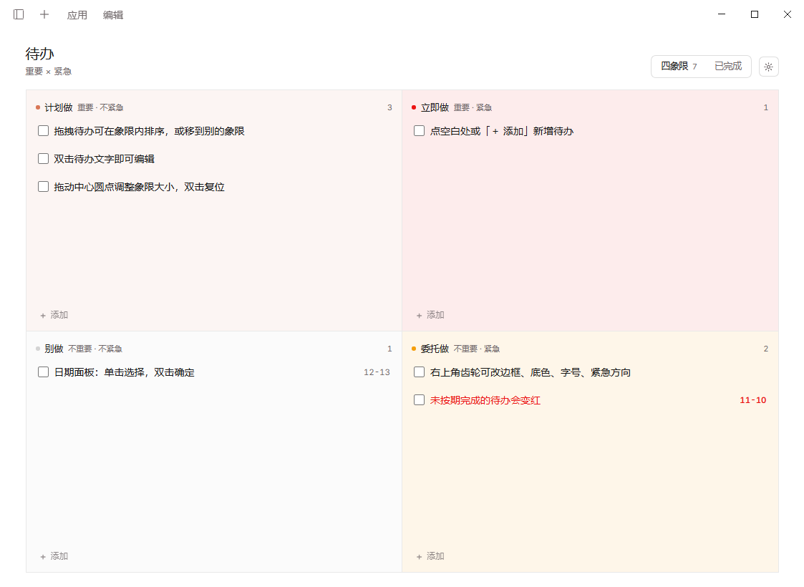
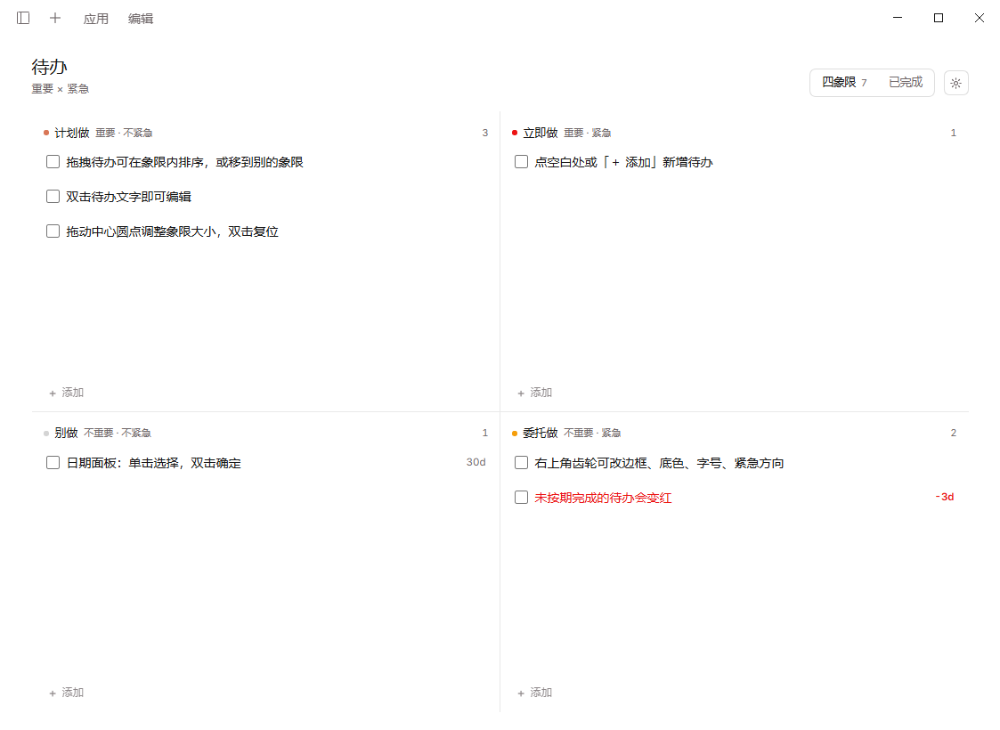

<p align="center">
  
  
  
</p>

---

## 1. 它是什么

DeepSeek Harness 的侧栏四象限待办插件。主界面就是艾森豪威尔矩阵（重要 × 紧急），右上角一键切换「已完成」视图；所有数据只存在你本机的一个 JSON 文件里。

- **不是一条长列表**：待办天然落在「立即做 / 计划做 / 委托做 / 别做」四个象限，拖到别的象限就自动改「重要 / 紧急」标记
- **到期会提醒**：当天到期加粗警示，逾期整行转红；日期（`11-15`）或倒计时（`7d`、`-3d`）两种显示可切换
- **首开有引导**：第一次打开且清单为空时，自动写入 7 条本地化引导待办，覆盖四个象限的用法；删掉后不再出现
- **布局随你调**：紧急列左右、边框风格、象限底色、圆角、字号、行列比例（拖中心圆点，双击复位）
- **跟随主题**：界面颜色全部取自 Harness 主题 token，明暗外观自动适配
- **中英双语**：文案跟随 Harness 语言设置

## 2. 效果预览

四象限面板（淡彩底色版）：



同一面板（纯净底色版）：



| 区域 | 你能做什么 |
|---|---|
| 标题行（左上） | 「待办 · 重要 × 紧急」定位说明 |
| 顶部切换（右上） | 「四象限 ↔ 已完成」两个视图互切，已完成可恢复或删除 |
| 象限头部 | 象限名、重要/紧急标记、本象限计数 |
| 待办行 | 勾选完成；双击标题就地编辑；日期固定在最右侧 |
| 象限空白处 /「＋ 添加」 | 就地新增一条属于该象限的待办 |
| 矩阵中心圆点 | 拖动调整行列比例，双击恢复均分 |

## 3. 快速开始

### 3.1 前置条件

| 项目 | 要求 |
|---|---|
| DeepSeek Harness | 桌面版已安装可用 |
| 运行环境 | Host 自带 Node.js ≥ 22，无需单独安装 |
| 权限 | 可读写 Harness profile 数据目录 |

### 3.2 安装

从 npm 安装（推荐）：

```bash
dsh plugin --profile desktop add dsh-matrix-todo
```

或在 Harness 的插件市场里搜索 `dsh-matrix-todo` 点击安装。

从源码目录安装（想直接改代码的人）：

```bash
git clone https://github.com/Zhang-Eli/dsh-matrix-todo.git
```

然后在 Harness 插件管理工具里：

```text
plugin_manager install_bundle  target: <本仓库绝对路径>
```

安装后**重启 DeepSeek Harness** 生效。

### 3.3 首次配置

1. 打开侧栏「四象限待办」入口。
2. 空清单首开自动出现 7 条引导待办，教你拖拽排序、双击编辑、日期面板。
3. 试一遍：把一条待办拖进别的象限；双击标题改名；点日历按钮设截止日期（单击预览、双击确认）。
4. 右上角齿轮可调边框、底色、字号、紧急方向；改完即时生效并自动保存。

### 3.4 在新环境还原

全部数据就一个文件：

```text
%DSH_PROFILE_DIR%\data\dsh-matrix-todo\todos.json
```

把它拷到新环境同一位置，装好插件即全部回来（待办 + 界面设置）。想放别处，在插件配置里覆盖：

```yaml
- id: matrix-todo
  config:
    dataPath: 'D:\notes\todos.json'
```

### 3.5 验证

- 重启后侧栏出现「四象限待办」；
- 打开面板能看到四个象限，首开空清单自动出现 7 条引导；
- 数据文件在上面的路径存在。

## 4. 设计取舍

- **不提供 agent 工具**：Harness 已自带待办工具 `personal_todo`，面板刻意不再暴露第二套待办语义，避免两个真源。
- **引导只写一次**：删掉引导即视为「已学会」，之后不会再自动回来；想再看见见常见问题。
- **单文件 + 原子写盘**：数据以「临时文件 + 替换」方式落盘，中途断电不损坏原文件；文件真损坏时先备份为 `todos.corrupt-<时间戳>.json`，再以空清单启动。
- **装完要重启**：面板在 Harness 启动时挂载，没有热更新。
- **颜色只用主题 token**：面板不自带配色，深色浅色模式都自动融入。
- **新条目排最前**：没手动排序前按创建时间倒序派生；一旦拖过，你的顺序就是最终顺序。

## 5. 卸载与回滚

```bash
dsh plugin --profile desktop remove dsh-matrix-todo
```

或在插件市场移除，然后重启 Harness。

- 卸载**不会**删除你的待办数据，`todos.json` 仍在数据目录；
- 想彻底清掉数据：删除 `%DSH_PROFILE_DIR%\data\dsh-matrix-todo\` 目录；
- 回滚：把备份（`todos.corrupt-<时间戳>.json` 或你自己的拷贝）恢复为 `todos.json` 再启动。

## 6. 常见问题

**装完侧栏没有「四象限待办」？**
重启 DeepSeek Harness，面板在启动时加载。

**怎么让 7 条引导待办再出现？**
清空全部待办，把 `todos.json` 里的 `seeded` 改成 `false`，重启 Harness 再打开面板。

**待办怎么变红了？**
截止日期已过。今天到期会加粗警示，逾期日期和标题都转红；设置里可在「日期 / 倒计时」两种显示间切换。

**手改 todos.json 好像没生效？**
非法值会被忽略并回落默认。请退出 Harness 后再编辑，或改完重启让它重新读取。

**换机器 / 换盘怎么迁移？**
拷 `todos.json` 到新环境同一位置即可；也可以用 `dataPath` 指定自定义路径（见 3.4）。

**有没有批量操作？**
没有多选；一次拖拽移动一条。唯一的批量入口是「清空已完成」，需要二次确认。

## 7. License

MIT © Zhang-Eli，详见 `LICENSE`。
